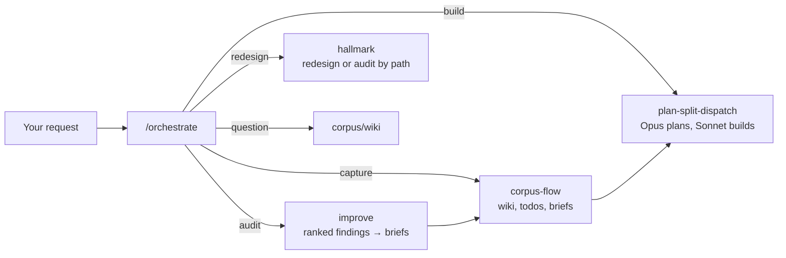

# personal-skills

A skill library for [Claude Code](https://claude.com/claude-code) that runs a project's work through one front door: a project wiki, briefs, model-routed implementation, plus a design, docs and review layer.

```
/orchestrate add dark mode to the settings page
```

`/orchestrate` makes sure the repo has a `corpus/` workspace, reads `corpus/routing.md`, works out what kind of request this is, shows a plan, and hands off once you approve: capture to `corpus-flow`, build to `plan-split-dispatch`, audits to `improve`, redesigns to Hallmark, questions to the wiki. It routes; it never does the work itself.

**Status:** Personal library, in daily use on the owner's projects. Version 0.51.0, 32 skills.

## What it does

- Keeps each project's knowledge in an LLM-maintained wiki (`corpus/`) with a glossary, a decisions log and a todos → briefs → done lifecycle.
- Splits implementation across models: Opus plans and reviews, Sonnet does most chunks, with a review gate before anything counts as done.
- Gives design work a vocabulary and a build engine (Hallmark for every redesign, impeccable, 74 brand `DESIGN.md` references, the taste presets on request) instead of one-off styling.
- Sets one standard for READMEs, docs sites, diagrams and prose across every repo.
- Keeps TypeScript repos to one house style: shared configs vendored into each repo, `npm run check` as the gate, and two hooks that format each saved file and run the repo's fast check before an agent can finish.
- Orients each session on the repo's corpus: a `SessionStart` hook puts the catalog, a fresh `resume` checkpoint and the open brief names in context (about 2,000 characters at most), and does nothing in a repo without a `corpus/`.

Use it if you want the same workflow in every repo and are happy with an opinionated one. It is tuned to one person's projects; the rules in it are deliberate, not neutral defaults.

## How it works



Every route stops for your approval before it does anything. Briefs are grilled (`grill-me`) before they are built, and the wiki records what was decided and why.

## What's inside

**Front door and core loop**

| Skill | What it does |
|---|---|
| `/orchestrate` | Work-intake router: bootstraps `corpus/`, classifies the request, presents a Route Plan, hands off after approval |
| `corpus-flow` | The project wiki (glossary, decisions, domain modeling in §9) plus the todos → briefs → done + log lifecycle, with `blocked/` folders for work that waits on something outside |
| `plan-split-dispatch` | Plans a task, splits it into chunks, routes them by difficulty, verifies the result through a review gate |
| `grill-me` | Stress-tests a plan in dependency-ordered rounds, finds facts itself, records settled terms and decisions |
| `improve` | Read-only survey of a codebase: vetted, ranked findings, with the ones you pick written up as briefs |

**Documentation and prose**

| Skill | What it does |
|---|---|
| `readme-docs` | One standard for README + `docs/`: a short landing page, a docs folder, real screenshots and GIFs without personal data |
| `corpus-docs-site` | A Docusaurus docs site: the narrative rendered from `corpus/`, the API reference generated from the TypeScript; also migrates a Starlight site without changing its URLs |
| `diagram-design` | 39 editorial diagram types as self-contained HTML+SVG (MIT) |
| `writing-guidelines` | Prose review against Vercel's Writing Guidelines, fetched fresh each run (MIT) |
| `unslop` | Cuts AI tells from writing (MIT) |

**Code understanding, style and review**

| Skill | What it does |
|---|---|
| `codegraph` | Scope a change with a code graph (impact, callers), confirm with grep + read |
| `thermo-nuclear-review` | A very strict maintainability review; use it deliberately (MIT) |
| `diagnose` | Debug by building a fast, deterministic pass/fail loop first, then one hypothesis at a time, then a fix that keeps the loop as a regression test; stops and asks when no loop can be built |
| `stocktake` | Audits the library's own skills for token cost, rules past the compaction cut and stale text, and ranks what is worth fixing; also a static check that MCP servers are pinned |
| `house-style` | The house TypeScript style as numbered rules, each with its lint rule or a review check, and how a repo adopts the harness: configs vendored from `house-style/`, one reformat commit, `npm run check` and `check:fast` |
| `code-structure` | One structure for the Fastify servers and React apps: 11 numbered rules, each with its source and its `check-structure` id, dependency-cruiser rule or review; skeletons compiled and tested against Fastify 5.12.8 with the zod type provider; the order every server's migration follows |

**Design and build**

| Skill | What it does |
|---|---|
| `hallmark` | The design skill every web UI's redesign uses: a Floor of 16 rules no page ships without, a tiered browser lint, themes dealt per page, credited Wikimedia photographs; `/hallmark redesign <path>` or `audit <path>` (MIT) |
| `impeccable` | The design build engine: 23 sub-commands, an anti-pattern detector, live browser iteration (Apache-2.0) |
| `design-taste-frontend` + `minimalist-ui`, `industrial-brutalist-ui`, `high-end-visual-design` | Anti-slop frontend direction and presets, held at their 2026-08 pin and run only when called by name; each defers to impeccable on conflict (MIT) |
| `design-pipeline` | A redesign run as a judged competition: two directions, two sketches, two blind judges in reversed order with today as a contestant, then the winner's full build, a critic against today and fix rounds; with the pair maker and the measured cost per app |
| `design-md-library` | 74 real-brand `DESIGN.md` references and the method for adapting one into your own tokens, plus palettes and type dealt by trade and a copy layer for Hallmark runs |
| `base-ui` | React UI on Base UI with Tailwind: 17 numbered rules, each with its `check-base-ui` id or review, copy-ready wrappers compiled against Base UI 1.9.0, the Light / Dark / System switch, and the method for moving an app from plain CSS to Tailwind |
| `web-design-guidelines` | UI review against Vercel's Web Interface Guidelines, fetched fresh each run (MIT) |
| `vercel-react-best-practices`, `vercel-composition-patterns`, `vercel-react-view-transitions`, `vercel-react-native-skills` | Vercel Engineering's React, component-API and animation guidance (MIT) |

**Shipping**

| Skill | What it does |
|---|---|
| `ui-test-plans` | Plain-text UI test plans plus a Playwright run hub, screenshots kept out of git |
| `bootstrap-vps-deploy` | A zero-dependency static-client + pm2-service deploy behind Caddy |

## Install and update

```
/plugin marketplace add <owner>/my-personal-skills
/plugin install personal-skills@personal-skills-marketplace
```

Restart Claude Code (or reload) so the command, skills and hooks are picked up. To update later:

```
/plugin marketplace update personal-skills-marketplace
```

### Workflow agents

Four agents for brief runs carry hooks that enforce their rules. Claude Code ignores hooks in a plugin's agents, so install user-level copies:

```
node scripts/install-agents.mjs --dry-run   # what it would write
node scripts/install-agents.mjs             # agents and the guard hook into the user's .claude folder
```

| Agent | Model | What it does |
|---|---|---|
| `brief-builder` | sonnet | Builds one brief in one repo and commits locally. It can't push, start sub-agents, pkill, build docker images, read `.env` files or kill another agent's process |
| `screen-capturer` | sonnet | Screenshots of one or more apps, seeded and headless. It writes only to its marked folders and changes no repo |
| `brief-auditor` | sonnet | A draft. Checks a built brief's acceptance lines and review-only rules, read only |
| `owner-steps` | haiku | Compiles the deploy list per stack from the board, read only, and flags a wrong deploy phase |

`node scripts/verify-brief.mjs <repo> <base>` is the mechanical half of the verify gate, the one the controller runs on each result.

### Design team agents

Four agents for the `design-pipeline` skill. They carry no hooks, so the plugin's copies work as they are.

| Agent | Model | What it does |
|---|---|---|
| `design-director` | opus | Writes two directions for one app's redesign (A evolve today, B the boldest structural answer), one content fixture and the main screen to sketch |
| `design-sketcher` | sonnet | Draws one direction's main screen and renders the two viewports the judges compare, with the Floor checks |
| `design-judge` | opus | Picks the better of each blind pair, hard gates (structure, legibility) first, then a weighted rubric; read only |
| `design-critic` | opus | Reviews the winner's full build against today, first-screen density and regressions first; edits nothing |

### Other agents

The skills follow the Agent Skills format (`SKILL.md` with `name` and `description`), so another agent that reads it can use them. In opencode and similar agents, copy or link `skills/` into `~/.agents/skills/` (or a project's `.agents/skills/`). The slash commands, the plugin's agents and its hooks are Claude Code only. A few skills use Claude Code frontmatter keys (`when_to_use` and others), which other agents ignore. `node scripts/check-skills.mjs` checks every skill against the portable limits.

## Docs

- [docs/](docs/README.md): the library's history, version by version
- [ATTRIBUTION.md](ATTRIBUTION.md): every vendored skill with its upstream, license and pinned commit, and the work that influenced the first-party skills
- Each skill's own `skills/<name>/SKILL.md`

## License

The plugin's own code is [MIT](LICENSE). Vendored skills keep their original licenses (MIT or Apache-2.0); see [ATTRIBUTION.md](ATTRIBUTION.md).
