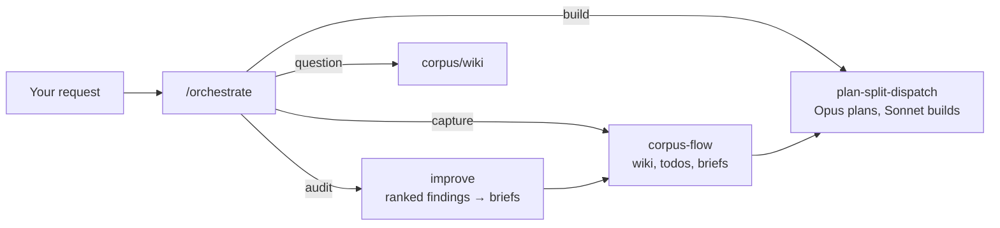

# personal-skills

A skill library for [Claude Code](https://claude.com/claude-code) that runs a project's work through one front door: a project wiki, briefs, model-routed implementation, plus a design, docs and review layer.

```
/orchestrate add dark mode to the settings page
```

`/orchestrate` makes sure the repo has a `corpus/` workspace, reads `corpus/routing.md`, works out what kind of request this is, shows a plan, and hands off once you approve: capture to `corpus-flow`, build to `plan-split-dispatch`, audits to `improve`, questions to the wiki. It routes; it never does the work itself.

**Status:** Personal library, in daily use on the owner's projects. Version 0.30.0, 26 skills.

## What it does

- Keeps each project's knowledge in an LLM-maintained wiki (`corpus/`) with a glossary, a decisions log and a todos → briefs → done lifecycle.
- Splits implementation across models: Opus plans and reviews, Sonnet does most chunks, with a review gate before anything counts as done.
- Gives design work a vocabulary and a build engine (impeccable, the taste presets, 74 brand `DESIGN.md` references) instead of one-off styling.
- Sets one standard for READMEs, docs sites, diagrams and prose across every repo.

Use it if you want the same workflow in every repo and are happy with an opinionated one. It is tuned to one person's projects; the rules in it are deliberate, not neutral defaults.

## How it works



Every route stops for your approval before it does anything. Briefs are grilled (`grill-me`) before they are built, and the wiki records what was decided and why.

## What's inside

**Front door and core loop**

| Skill | What it does |
|---|---|
| `/orchestrate` | Work-intake router: bootstraps `corpus/`, classifies the request, presents a Route Plan, hands off after approval |
| `corpus-flow` | The project wiki (glossary, decisions, domain modeling in §9) plus the todos → briefs → done + log lifecycle |
| `plan-split-dispatch` | Plans a task, splits it into chunks, routes them by difficulty, verifies the result through a review gate |
| `grill-me` | Stress-tests a plan in dependency-ordered rounds, finds facts itself, records settled terms and decisions |
| `improve` | Read-only survey of a codebase: vetted, ranked findings, with the ones you pick written up as briefs |

**Documentation and prose**

| Skill | What it does |
|---|---|
| `readme-docs` | One standard for README + `docs/`: a short landing page, a docs folder, real screenshots and GIFs without personal data |
| `corpus-docs-site` | A Starlight docs site: the narrative rendered from `corpus/`, the API reference generated from the TypeScript |
| `diagram-design` | 39 editorial diagram types as self-contained HTML+SVG (MIT) |
| `writing-guidelines` | Prose review against Vercel's Writing Guidelines, fetched fresh each run (MIT) |
| `unslop` | Cuts AI tells from writing (MIT) |

**Code understanding and review**

| Skill | What it does |
|---|---|
| `codegraph` | Scope a change with a code graph (impact, callers), confirm with grep + read |
| `thermo-nuclear-review` | A very strict maintainability review; use it deliberately (MIT) |

**Design and build**

| Skill | What it does |
|---|---|
| `impeccable` | The design build engine: 23 sub-commands, an anti-pattern detector, live browser iteration (Apache-2.0) |
| `design-taste-frontend` + `minimalist-ui`, `industrial-brutalist-ui`, `high-end-visual-design`, `redesign-existing-projects` | Anti-slop frontend direction and presets; each defers to impeccable on conflict (MIT) |
| `design-md-library` | 74 real-brand `DESIGN.md` references and the method for adapting one into your own tokens |
| `web-design-guidelines` | UI review against Vercel's Web Interface Guidelines, fetched fresh each run (MIT) |
| `vercel-react-best-practices`, `vercel-composition-patterns`, `vercel-react-view-transitions`, `vercel-react-native-skills` | Vercel Engineering's React, component-API and animation guidance (MIT) |

**Shipping**

| Skill | What it does |
|---|---|
| `ui-test-plans` | Plain-text UI test plans plus a Playwright run hub, screenshots kept out of git |
| `bootstrap-vps-deploy` | A zero-dependency static-client + pm2-service deploy behind Caddy |

## Install and update

```
/plugin marketplace add gandolh/my-personal-skills
/plugin install personal-skills@personal-skills-marketplace
```

Restart Claude Code (or reload) so the command and skills are picked up. To update later:

```
/plugin marketplace update personal-skills-marketplace
```

## Docs

- [docs/](docs/README.md): the library's history, version by version
- [ATTRIBUTION.md](ATTRIBUTION.md): every vendored skill with its upstream, license and pinned commit, and the work that influenced the first-party skills
- Each skill's own `skills/<name>/SKILL.md`

## License

The plugin's own code is [MIT](LICENSE). Vendored skills keep their original licenses (MIT or Apache-2.0); see [ATTRIBUTION.md](ATTRIBUTION.md).
